# MitraDidik: Dokumen PRD, ERD, Kelebihan, Inovasi, dan Arsitektur Sistem

Portal kemitraan aktif antara **Orang Tua dan Guru** yang dikelola terpusat oleh **Admin Sekolah**, dirancang untuk mendampingi perkembangan akademik, kehadiran, kedisiplinan, budi pekerti, serta komunikasi interaktif per mata pelajaran bagi peserta didik.

---

## 1. Ringkasan Produk

Aplikasi sekolah pada umumnya hanya berfungsi sebagai papan pengumuman satu arah (sekolah ke orang tua) yang dingin dan kaku. **MitraDidik** menghadirkan kolaborasi dua arah yang transparan, aman, dan tertata, dilengkapi sistem obrolan (*chat*) terarah antara orang tua dan guru mata pelajaran, serta panel kendali lengkap bagi Admin Sekolah untuk mengelola data dan memoderasi interaksi.

### Peran Pengguna (User Roles)
Sistem memiliki **3 peran pengguna resmi**:
1. **Admin Sekolah (`admin`)**:
   - Mengelola master data sekolah (tahun ajaran, kelas, mata pelajaran, alokasi guru mata pelajaran dan wali kelas).
   - Mengelola akun pengguna (guru dan orang tua) serta relasi wali murid terhadap siswa.
   - Mengatur kebijakan operasional sekolah, jam kerja, dan **Jam Tenang (*Quiet Hours*)**.
   - Memantau dasbor sistem, mengelola pengaturan izin, serta memoderasi sistem chat dan log audit kepatuhan.
2. **Guru (`teacher`)**:
   - **Guru Wali Kelas**: Mengelola presensi harian, mengonfirmasi permohonan izin/sakit orang tua, mencatat poin merit (budi luhur) dan demerit (pelanggaran), serta merespons chat umum/konsultasi.
   - **Guru Mata Pelajaran (Mapel)**: Menghubungkan Google Classroom untuk menyinkronkan tugas dan nilai, menginput nilai manual, serta berinteraksi via chat khusus mata pelajaran dengan orang tua murid yang diajarnya.
3. **Orang Tua / Wali (`guardian`)**:
   - Memantau kehadiran harian dan rekapitulasi bulanan anak.
   - Mengajukan surat permohonan izin/sakit digital langsung ke guru wali kelas.
   - Memantau daftar tugas (terkoneksi Google Classroom), tenggat waktu, dan status pengerjaan ("Sudah" atau "Belum").
   - Memantau nilai tugas per mata pelajaran beserta catatan guru.
   - Memantau buku saku perilaku digital anak (poin merit budi luhur dan demerit 100-ke-0).
   - Melakukan obrolan (*chat*) langsung dengan guru mata pelajaran spesifik atau wali kelas anak mereka.

> [!NOTE]
> **Siswa (`students`)** bertindak sebagai subjek data perkembangan yang dipantau bersama oleh guru dan orang tua. Siswa **tidak memiliki akun login mandiri** di aplikasi ini. Pemantauan tugas dan pembelajaran siswa dihubungkan langsung dari Google Classroom yang digunakan siswa di sekolah.

---

## 2. Kelebihan Produk

| Kelebihan | Penjelasan |
| --- | --- |
| **Chat Terarah Sesuai Guru Mapel** | Orang tua dapat langsung berkomunikasi secara privat dengan guru mata pelajaran yang bersangkutan (misal: Guru Matematika, Guru Bahasa Inggris) atau Wali Kelas mengenai perkembangan belajar anaknya tanpa nomor telepon pribadi tersebar. |
| **Manajemen Terpusat oleh Admin** | Admin sekolah memiliki kendali penuh atas struktur data akademik (guru, kelas, mapel, siswa, wali), pengaturan Jam Tenang, serta pengawasan moderasi percakapan untuk menjaga etika komunikasi sekolah. |
| **Presensi Transparan & Izin Dua Arah** | Orang tua mengetahui kehadiran anak setiap hari secara real-time. Jika anak berhalangan, orang tua mengirim izin/sakit disertai bukti surat, yang dikonfirmasi langsung oleh guru wali kelas. Tersedia rekapan bulanan otomatis untuk keterlambatan dan ketidakhadiran. |
| **Transparansi Tugas via Google Classroom** | Orang tua tidak perlu lagi menebak atau bertanya apakah ada pekerjaan rumah. Seluruh tugas, instruksi, batas waktu (*deadline*), dan status pengumpulan ("Sudah" atau "Belum") disinkronkan otomatis dari Google Classroom API. |
| **Akses Nilai Tugas Terbuka & Informatif** | Nilai tugas yang dinilai guru (baik di Google Classroom maupun input langsung) tersaji lengkap beserta catatan perbaikan (*feedback*), membantu orang tua memahami capaian belajar anak. |
| **Pendidikan Karakter Berimbang (Merit & Demerit)** | Tidak hanya menghukum pelanggaran, sistem mengapresiasi kebaikan melalui **Merit Budi Luhur** (poin prestasi bertambah) dan mengawasi kedisiplinan melalui **Demerit** (baseline 100 poin yang berkurang menuju 0 saat melanggar). |
| **Melindungi Waktu Istirahat Guru (Jam Tenang)** | Pesan chat dari orang tua di luar jam operasional akan otomatis ditahan (*held*) dan dikirimkan saat jam kerja berikutnya, mencegah kelelahan mental (*burnout*) guru. |

---

## 3. Inovasi Utama

1. **Kanal Chat Terkontekstualisasi Per Guru Mapel & Anak**:
   Orang tua yang memiliki beberapa anak atau ingin menanyakan mata pelajaran tertentu tidak akan salah sasaran; kanal chat otomatis dikelompokkan berdasarkan anak dan guru mata pelajaran yang mengajar di kelasnya.
2. **Panel Kendali & Moderasi Admin Sekolah**:
   Admin dapat memantau kesehatan komunikasi sekolah, mengonfigurasi jam kerja dan Jam Tenang, serta mengarsipkan ruang obrolan demi transparansi dan akuntabilitas.
3. **Jembatan Google Classroom API (Parent Visibility Bridge)**:
   Mengubah data Google Classroom yang selama ini hanya bisa dilihat oleh siswa dan guru menjadi dasbor transparan yang mudah dipahami oleh orang tua (status pengerjaan "Sudah" / "Belum" & nilai tugas).
4. **Alur Izin & Rekapitulasi Presensi Terintegrasi**:
   Pengajuan izin digital dari orang tua langsung masuk ke daftar verifikasi guru wali kelas. Setelah disetujui, absensi otomatis terbarui dan diakumulasikan ke dalam rekap bulanan (hadir, terlambat, sakit, izin, alpa).
5. **Sistem Karakter Ganda: Merit Budi Luhur + Demerit 100-ke-0**:
   Kombinasi apresiasi karakter luhur positif (akumulatif mulai dari 0) dan sistem batas kedisiplinan kuota (100 poin berkurang menuju 0) dengan peringatan bertingkat otomatis ke orang tua.
6. **Fitur Jam Tenang Guru (Quiet Hours Protection)**:
   Menjaga etika dan batasan komunikasi sekolah-rumah dengan menunda pengiriman pesan di luar jam operasional.

---

## 4. Spesifikasi Fitur Utama

### 4.1 Modul Sistem Chat Orang Tua - Guru (Berbasis Mata Pelajaran & Wali Kelas)
- **Daftar Kontak Terarah Berdasarkan Mata Pelajaran**:
  - Orang tua memilih anak yang ingin dikonsultasikan -> aplikasi menampilkan daftar guru yang mengajar di kelas anak tersebut:
    - **Wali Kelas**: Untuk konsultasi umum, presensi, kedisiplinan, dan perkembangan holistik.
    - **Guru Mata Pelajaran (Mapel)**: Khusus untuk materi belajar, tugas, dan nilai mata pelajaran tertentu (misal: Matematika - Pak Ahmad, IPA - Ibu Dewi, dsb.).
  - Orang tua hanya dapat mengontak guru yang memang terdaftar mengajar anak mereka pada tahun ajaran aktif (`class_teachers`).
- **Ruang Obrolan Kontekstual (*Chat Rooms*)**:
  - Setiap ruang obrolan mengikat kombinasi unik: `(student_id, teacher_id, guardian_id, subject_id)`.
  - Tampilan chat menampilkan identitas siswa yang sedang dibahas dan mata pelajaran terkait di bagian atas (*header chat*).
- **Format Pesan & Lampiran Media**:
  - Mendukung pengiriman teks, gambar (misal: foto lembar tugas anak), dan dokumen PDF.
  - Indikator status pesan: `sent` (terkirim), `delivered` (diterima di perangkat), `read` (telah dibaca), dan `held` (ditahan karena Jam Tenang).
- **Penerapan Jam Tenang (*Quiet Hours*) pada Chat**:
  - Jika orang tua mengirimkan pesan pada malam hari atau hari libur (di luar jadwal sekolah yang diatur Admin), sistem menampilkan notifikasi ramah: *"Pesan Anda akan otomatis disampaikan kepada guru pada jam dinas berikutnya (pk 07.00 WIB)"*.
  - Guru tidak diganggu oleh notifikasi obrolan saat jam istirahat.
- **Notifikasi Obrolan Baru**:
  - Push notification di aplikasi dan opsional jembatan notifikasi WhatsApp pemberitahuan adanya pesan baru.

---

### 4.2 Modul Pengaturan & Manajemen Admin Sekolah
- **Manajemen Master Data Akademik**:
  - Mengelola data Sekolah (profil, NPSN, logo, jam operasional, rentang Jam Tenang).
  - Mengelola Tahun Ajaran aktif dan semester.
  - Mengelola Rombongan Belajar (Kelas) dan Tingkatan Kelas (*Grade Level*).
  - Mengelola Mata Pelajaran (Nama, Kode Mapel).
  - Menetapkan Penugasan Guru: Guru Wali Kelas (*Homeroom*) dan Guru Mata Pelajaran (*Subject Teachers*) untuk masing-masing kelas.
- **Manajemen Pengguna & Otorisasi**:
  - Mengundang/mendaftarkan akun Guru dan akun Orang Tua.
  - Memetakan relasi siswa dan orang tua (`student_guardians`), termasuk menetapkan wali utama (*primary guardian*).
  - Menangani reset kata sandi, aktivasi, dan deaktivasi akun pengguna.
- **Panel Pengawasan & Moderasi Komunikasi (Admin Moderation)**:
  - Melihat direktori ruang chat aktif di sekolah.
  - Menangani eskalasi atau laporan jika terdapat komunikasi yang tidak patut.
  - Mengatur template pesan resmi sekolah dan pesan pembuka otomatis.
  - Mengaudit log aktivitas sistem (`audit_logs`) untuk mendeteksi perubahan data sensitif.

---
    
### 4.3 Modul Absensi Siswa (Presensi Harian & Rekapitulasi Bulanan)
- **Laporan Presensi Harian (Real-time Daily Report)**:
  - Guru kelas mencatat presensi harian siswa (Hadir, Terlambat, Sakit, Izin, Alpa).
  - Untuk status **Terlambat**, guru mencatat waktu kedatangan (`check_in_time`) dan akumulasi menit keterlambatan (`minutes_late`).
  - Orang tua menerima laporan/notifikasi harian di beranda aplikasi mengenai status kehadiran anaknya pada hari tersebut.
- **Pengajuan Izin Tidak Masuk dari Orang Tua (Leave Request)**:
  - Orang tua dapat mengajukan izin tidak masuk sekolah (kategori: **Sakit** atau **Izin**).
  - Formulir pengajuan mencakup: rentang tanggal (mulai & selesai), alasan keterangan, serta lampiran bukti digital (surat dokter / surat izin bertanda tangan).
  - Status pengajuan: `pending` (menunggu konfirmasi), `approved` (disetujui guru), atau `rejected` (ditolak).
- **Konfirmasi & Verifikasi Guru**:
  - Guru wali kelas menerima notifikasi dan daftar pengajuan izin di dasbor guru.
  - Guru dapat memeriksa dokumen lampiran dan menekan tombol **Konfirmasi Setuju** atau **Tolak** dengan catatan.
  - Saat disetujui, sistem secara otomatis mengisi/memperbarui rekaman data absensi (`attendances`) siswa tersebut menjadi `sakit` atau `izin`.
- **Rekapan Bulanan Keterlambatan dan Ketidakhadiran**:
  - Tersedia menu rekapitulasi kehadiran per bulan untuk orang tua, guru, dan admin.
  - Metrik rekapan mencakup:
    - Total Hari Efektif Belajar.
    - Total Hari Hadir Tepat Waktu.
    - Total Hari Terlambat dan Akumulasi Menit Keterlambatan.
    - Total Hari Tidak Masuk (Sakit, Izin, Alpa).
    - Persentase Tingkat Kehadiran Bulanan (%).

---

### 4.4 Modul Tugas Siswa (Terhubung Google Classroom API)
- **Integrasi Google Classroom API**:
  - Guru menghubungkan akun Google Workspace for Education milik mereka melalui alur otorisasi OAuth 2.0.
  - Pemetaan kelas di MitraDidik ke Course yang ada di Google Classroom.
  - Sinkronisasi otomatis (via background worker) maupun manual (tombol sinkronisasi guru):
    - Mengambil daftar tugas (`courseWork`): Judul tugas, deskripsi, tenggat waktu (*due date & due time*), poin maksimal, dan tautan tugas Google Classroom.
    - Mengambil status penyerahan tugas siswa (`studentSubmissions`): Status pengumpulan, waktu penyerahan (*submission time*), indikator keterlambatan (*late*), dan nilai yang diberikan guru (*assignedGrade*).
  - Mendukung pembuatan tugas manual langsung di MitraDidik jika ada tugas non-Google Classroom.
- **Pemantauan Tugas untuk Orang Tua**:
  - Orang tua dapat melihat seluruh daftar tugas aktif dan riwayat tugas per mata pelajaran.
  - Informasi tenggat waktu ditampilkan secara jelas dengan indikator sisa waktu (misal: "Hari ini, pukul 23:59" atau "2 hari lagi").
  - **Status Pengerjaan Siswa**:
    - **Belum**: Tugas telah diberikan namun siswa belum mengumpulkan di Google Classroom.
    - **Sudah**: Siswa telah menyerahkan tugas di Google Classroom (`TURNED_IN` / `RETURNED`).
    - **Terlambat**: Tugas belum dikumpulkan padahal sudah melewati tenggat waktu, atau dikumpulkan melewati batas waktu.
    - **Dinilai**: Tugas sudah dinilai oleh guru.

---

### 4.5 Modul Nilai Siswa
- **Tampilan Nilai Tugas untuk Orang Tua**:
  - Orang tua dapat melihat nilai dari setiap tugas yang telah dinilai guru mapel.
  - Nilai tersinkronisasi otomatis dari Google Classroom (`assignedGrade`) atau diinput manual oleh guru di aplikasi.
  - Dilengkapi informasi skor perolehan, nilai maksimal tugas, dan catatan guru (*feedback*).
- **Rekap Capaian Tugas per Mata Pelajaran**:
  - Rangkuman rata-rata nilai tugas per mata pelajaran dalam semester berjalan.

---

### 4.6 Modul Karakter: Merit "Budi Luhur" & Demerit (100 ke 0)
- **Sistem Merit "Budi Luhur" (Poin Prestasi & Karakter Positif)**:
  - Poin **berkisar dari 0 dan bertambah secara akumulatif positif** (+5, +10, +25 poin, dst.).
  - Kategori merit meliputi: Prestasi Akademik/Lomba, Kepedulian Sosial & Gotong Royong, Kejujuran/Integritas, Budi Pekerti & Akhlak Mulia.
  - Setiap penambahan poin merit menghasilkan kartu apresiasi digital bagi orang tua.
- **Sistem Demerit (Poin Pelanggaran: 100 ke 0)**:
  - Setiap siswa mengawali semester dengan **modal 100 Poin Kedisiplinan**.
  - Setiap pelanggaran yang dilakukan siswa akan **mengurangi poin kedisiplinan menuju 0**.
  - **Tingkat Peringatan Dini Demerit (Warning Thresholds)**:
    - **100 – 85 Poin (Kondisi Baik/Hijau)**: Perilaku disiplin normal.
    - **84 – 70 Poin (Peringatan Tahap 1 / Kuning)**: Notifikasi peringatan otomatis ke orang tua dan konseling wali kelas.
    - **69 – 50 Poin (Peringatan Tahap 2 / Oranye)**: Surat Peringatan (SP 1) dan undangan konsultasi tatap muka orang tua ke sekolah.
    - **< 50 Poin (Peringatan Kritis / Merah)**: Surat Peringatan Keras (SP 2 / SP 3) dan penanganan khusus bersama Kepala Sekolah dan Guru BK.
- **Buku Saku Digital Perilaku**: Orang tua dapat melihat riwayat poin budi luhur dan demerit anak secara transparan.

---

## 5. ERD Lengkap (Entity Relationship Diagram)

Berikut diagram relasi database komprehensif yang telah diperbarui mencakup peran `admin`, sistem `chat_rooms` berbasis guru mapel, dan seluruh modul aplikasi:

```mermaid
erDiagram
  SCHOOLS ||--o{ USERS : memiliki
  SCHOOLS ||--o{ ACADEMIC_YEARS : memiliki
  SCHOOLS ||--o{ CLASSES : memiliki
  SCHOOLS ||--o{ SUBJECTS : memiliki
  SCHOOLS ||--o{ STUDENTS : memiliki
  SCHOOLS ||--o{ BEHAVIOR_CATEGORIES : memiliki
  SCHOOLS ||--o{ CHAT_ROOMS : memiliki

  ACADEMIC_YEARS ||--o{ CLASSES : mencakup
  ACADEMIC_YEARS ||--o{ STUDENT_BEHAVIOR_PROFILES : periode

  USERS ||--o| TEACHER_PROFILES : profil_guru
  USERS ||--o{ GOOGLE_CLASSROOM_TOKENS : punya_token
  USERS ||--o{ CLASS_TEACHERS : mengajar
  CLASSES ||--o{ CLASS_TEACHERS : diajar
  SUBJECTS ||--o{ CLASS_TEACHERS : mapel

  CLASSES ||--o{ STUDENTS : berisi
  STUDENTS ||--o{ STUDENT_GUARDIANS : punya_wali
  USERS ||--o{ STUDENT_GUARDIANS : menjadi_wali

  STUDENTS ||--o{ ATTENDANCES : presensi
  CLASSES ||--o{ ATTENDANCES : kelas_presensi
  USERS ||--o{ ATTENDANCES : dicatat_guru
  ATTENDANCE_REQUESTS ||--o| ATTENDANCES : menghasilkan

  STUDENTS ||--o{ ATTENDANCE_REQUESTS : permohonan_izin
  USERS ||--o{ ATTENDANCE_REQUESTS : diajukan_wali
  USERS ||--o{ ATTENDANCE_REQUESTS : dikonfirmasi_guru

  CLASSES ||--o{ GOOGLE_CLASSROOM_COURSES : dipetakan
  SUBJECTS ||--o{ GOOGLE_CLASSROOM_COURSES : mapel_gclass
  USERS ||--o{ GOOGLE_CLASSROOM_COURSES : pemilik_kursus

  CLASSES ||--o{ ASSIGNMENTS : tugas_kelas
  SUBJECTS ||--o{ ASSIGNMENTS : mapel_tugas
  USERS ||--o{ ASSIGNMENTS : dibuat_guru
  GOOGLE_CLASSROOM_COURSES ||--o{ ASSIGNMENTS : tugas_gclass

  ASSIGNMENTS ||--o{ ASSIGNMENT_SUBMISSIONS : lembar_tugas
  STUDENTS ||--o{ ASSIGNMENT_SUBMISSIONS : dikerjakan

  STUDENTS ||--o| STUDENT_BEHAVIOR_PROFILES : saldo_poin
  STUDENTS ||--o{ BEHAVIOR_RECORDS : riwayat_perilaku
  USERS ||--o{ BEHAVIOR_RECORDS : dicatat_guru
  BEHAVIOR_CATEGORIES ||--o{ BEHAVIOR_RECORDS : jenis_poin

  STUDENTS ||--o{ CHAT_ROOMS : subjek_anak
  CLASSES ||--o{ CHAT_ROOMS : kelas_chat
  SUBJECTS ||--o{ CHAT_ROOMS : mapel_chat
  USERS ||--o{ CHAT_ROOMS : guru_chat
  USERS ||--o{ CHAT_ROOMS : wali_chat
  CHAT_ROOMS ||--o{ CHAT_MESSAGES : memuat_pesan
  USERS ||--o{ CHAT_MESSAGES : pengirim_pesan

  STUDENTS ||--o{ STORIES : subjek_cerita
  USERS ||--o{ STORIES : ditulis_guru
  STORIES ||--o{ STORY_MEDIA : lampiran_foto

  USERS ||--o{ NOTIFICATIONS : penerima_notif
  USERS ||--o{ AUDIT_LOGS : aktor_audit

  SCHOOLS {
    uuid id PK
    string name
    string npsn
    time quiet_start
    time quiet_end
    string timezone
    timestamp created_at
  }

  USERS {
    uuid id PK
    uuid school_id FK
    string role "admin | teacher | guardian"
    string full_name
    string phone
    string email
    string password_hash
    boolean is_active
    timestamp created_at
  }

  TEACHER_PROFILES {
    uuid user_id PK, FK
    string nip
    string bio
    string photo_url
  }

  GOOGLE_CLASSROOM_TOKENS {
    uuid id PK
    uuid teacher_id FK
    string google_user_id
    string google_email
    text access_token
    text refresh_token
    timestamp token_expires_at
    boolean is_active
  }

  ACADEMIC_YEARS {
    uuid id PK
    uuid school_id FK
    string name
    date start_date
    date end_date
    boolean is_active
  }

  CLASSES {
    uuid id PK
    uuid school_id FK
    uuid academic_year_id FK
    string name
    int grade_level
  }

  SUBJECTS {
    uuid id PK
    uuid school_id FK
    string name
    string code
  }

  CLASS_TEACHERS {
    uuid id PK
    uuid class_id FK
    uuid teacher_id FK
    uuid subject_id FK "nullable jika hanya wali kelas"
    boolean is_homeroom
  }

  STUDENTS {
    uuid id PK
    uuid school_id FK
    uuid class_id FK
    string nis
    string nisn
    string full_name
    string gclass_student_email
    date birth_date
    string photo_url
  }

  STUDENT_GUARDIANS {
    uuid id PK
    uuid student_id FK
    uuid guardian_id FK
    string relation "ayah | ibu | wali"
    boolean is_primary
  }

  CHAT_ROOMS {
    uuid id PK
    uuid school_id FK
    uuid student_id FK
    uuid class_id FK
    uuid subject_id FK "nullable jika konsultasi wali kelas"
    uuid teacher_id FK
    uuid guardian_id FK
    string room_type "subject | homeroom"
    boolean is_active
    timestamp last_message_at "nullable"
    timestamp created_at
  }

  CHAT_MESSAGES {
    uuid id PK
    uuid room_id FK
    uuid sender_id FK
    string message_type "text | image | document"
    text message
    string attachment_url "nullable"
    string status "held | sent | delivered | read"
    timestamp deliver_at
    timestamp read_at "nullable"
    timestamp created_at
  }

  ATTENDANCES {
    uuid id PK
    uuid student_id FK
    uuid class_id FK
    uuid recorded_by FK
    uuid request_id FK "nullable"
    date att_date
    string status "hadir | terlambat | izin | sakit | alpa"
    time check_in_time "nullable"
    int minutes_late "default 0"
    string note "nullable"
    timestamp created_at
  }

  ATTENDANCE_REQUESTS {
    uuid id PK
    uuid student_id FK
    uuid guardian_id FK
    uuid reviewed_by FK "nullable"
    string type "izin | sakit"
    date start_date
    date end_date
    text reason
    string attachment_url "nullable"
    string status "pending | approved | rejected"
    text review_note "nullable"
    timestamp reviewed_at "nullable"
    timestamp created_at
  }

  GOOGLE_CLASSROOM_COURSES {
    uuid id PK
    uuid class_id FK
    uuid subject_id FK
    uuid teacher_id FK
    string gclass_course_id
    string course_name
    string alternate_link
    timestamp last_synced_at
  }

  ASSIGNMENTS {
    uuid id PK
    uuid class_id FK
    uuid subject_id FK
    uuid teacher_id FK
    uuid course_mapping_id FK "nullable"
    string gclass_coursework_id "nullable"
    string title
    text description "nullable"
    timestamp due_date "nullable"
    decimal max_points
    string alternate_link "nullable"
    string source "google_classroom | manual"
    string sync_status "synced | failed"
    timestamp created_at
  }

  ASSIGNMENT_SUBMISSIONS {
    uuid id PK
    uuid assignment_id FK
    uuid student_id FK
    string gclass_submission_id "nullable"
    string status "belum | sudah | terlambat | dinilai"
    string submission_state "NEW | CREATED | TURNED_IN | RETURNED | RECLAIMED"
    timestamp submitted_at "nullable"
    decimal score "nullable"
    text teacher_feedback "nullable"
    timestamp graded_at "nullable"
    timestamp last_synced_at
  }

  STUDENT_BEHAVIOR_PROFILES {
    uuid id PK
    uuid student_id FK
    uuid academic_year_id FK
    int initial_demerit_points "default 100"
    int current_demerit_points "range 100 down to 0"
    int total_merit_points "default 0, cumulative positive"
    string warning_level "normal | sp1 | sp2 | sp3"
    timestamp updated_at
  }

  BEHAVIOR_CATEGORIES {
    uuid id PK
    uuid school_id FK
    string type "merit | demerit"
    string name
    int points
    string severity_level "ringan | sedang | berat"
    text description "nullable"
  }

  BEHAVIOR_RECORDS {
    uuid id PK
    uuid student_id FK
    uuid teacher_id FK
    uuid category_id FK
    string type "merit | demerit"
    int points
    int demerit_point_balance_after "nullable"
    date incident_date
    string title
    text notes
    string evidence_url "nullable"
    text action_taken "nullable"
    timestamp created_at
  }

  STORIES {
    uuid id PK
    uuid student_id FK
    uuid teacher_id FK
    string mood "senang | biasa | perlu_perhatian"
    text body
    date story_date
    timestamp created_at
  }

  STORY_MEDIA {
    uuid id PK
    uuid story_id FK
    string url
    string media_type
  }

  NOTIFICATIONS {
    uuid id PK
    uuid user_id FK
    string channel "app | whatsapp"
    string title
    text message
    string ref_type
    uuid ref_id
    string status "pending | sent | failed"
    timestamp sent_at "nullable"
  }

  AUDIT_LOGS {
    uuid id PK
    uuid user_id FK
    string action
    string entity
    uuid entity_id
    timestamp created_at
  }
```



---

## 6. Kamus Data (Data Dictionary)

| Tabel | Kolom | Tipe Data & Nilai yang Diizinkan | Deskripsi Bisnis |
| --- | --- | --- | --- |
| `users` | `role` | `admin`, `teacher`, `guardian` | Peran akun: Administrator Sekolah, Guru (Mapel/Wali), dan Orang Tua. |
| `chat_rooms` | `room_type` | `subject`, `homeroom` | Jenis ruang obrolan: Khusus Mata Pelajaran tertentu atau Wali Kelas umum. |
| `chat_rooms` | `is_active` | `boolean` | Status ruang chat (aktif atau diarsipkan/ditutup oleh Admin/Guru). |
| `chat_messages` | `message_type` | `text`, `image`, `document` | Format konten pesan yang dikirimkan. |
| `chat_messages` | `status` | `held`, `sent`, `delivered`, `read` | Status pengiriman pesan (held jika dikirim saat Jam Tenang). |
| `chat_messages` | `deliver_at` | `timestamp` | Waktu sebenarnya pesan diserahkan ke penerima (ditunda jika jam tenang). |
| `attendances` | `status` | `hadir`, `terlambat`, `izin`, `sakit`, `alpa` | Status presensi siswa pada tanggal terkait. |
| `attendances` | `minutes_late` | `integer (>= 0)` | Jumlah menit keterlambatan masuk sekolah. |
| `attendance_requests` | `type` | `izin`, `sakit` | Kategori surat permohonan tidak masuk dari orang tua. |
| `attendance_requests` | `status` | `pending`, `approved`, `rejected` | Alur verifikasi surat izin oleh guru wali kelas. |
| `assignments` | `source` | `google_classroom`, `manual` | Asal tugas: sinkronisasi otomatis Google Classroom atau input guru. |
| `assignment_submissions` | `status` | `belum`, `sudah`, `terlambat`, `dinilai` | Status pengerjaan tugas yang dilihat orang tua. |
| `assignment_submissions` | `score` | `decimal (0.00 s/d 100.00)` | Nilai tugas yang disinkronkan dari Classroom atau diinput guru. |
| `student_behavior_profiles`| `initial_demerit_points`| `integer (default 100)` | Kuota awal poin kedisiplinan per semester/tahun ajaran. |
| `student_behavior_profiles`| `current_demerit_points`| `integer (0 s/d 100)` | Saldo berjalan poin demerit (berkurang menuju 0 saat melanggar). |
| `student_behavior_profiles`| `total_merit_points` | `integer (>= 0)` | Akumulasi perolehan poin prestasi & budi luhur. |
| `student_behavior_profiles`| `warning_level` | `normal`, `sp1`, `sp2`, `sp3` | Tingkat sanksi berdasarkan saldo poin demerit. |
| `behavior_categories` | `type` | `merit`, `demerit` | Klasifikasi kategori: penambah prestasi atau pengurang disiplin. |

---

## 7. Aturan Bisnis & Integritas Data

### 7.1 Aturan Sistem Chat Orang Tua - Guru Berbasis Mapel & Moderasi Admin
1. **Validasi Pembuatan Ruang Chat (`chat_rooms`)**:
   - Ruang chat hanya dapat terbentuk antara `guardian` yang terdaftar pada `student_guardians` untuk siswa tersebut, dan `teacher` yang mengajar kelas siswa tersebut (`class_teachers`).
   - Tipe obrolan:
     - `subject`: Terhubung ke `subject_id` spesifik, ditujukan kepada Guru Pengampu Mapel tersebut.
     - `homeroom`: `subject_id = null`, ditujukan kepada Guru Wali Kelas untuk mendiskusikan hal umum, presensi, atau perilaku anak.
   - Bersifat *one-to-one* privat per konteks: Tidak dapat dimasuki oleh orang tua lain.
2. **Aturan Jam Tenang (*Quiet Hours*) pada Pesan Chat**:
   - Ketika orang tua mengirim pesan saat waktu berada dalam rentang `schools.quiet_start` s/d `schools.quiet_end`:
     - Pesan disimpan dengan `status = 'held'`.
     - Nilai `deliver_at` disetel ke waktu `schools.quiet_end` hari kerja berikutnya.
     - Penerima (guru) tidak menerima *push notification* pada jam tenang.
     - Job terjadwal otomatis mengubah status menjadi `'sent'` dan mengirimkan notifikasi saat `deliver_at` tercapai.
3. **Wewenang & Pengawasan Admin Sekolah**:
   - Admin memiliki akses melihat log metadata percakapan (frekuensi chat, waktu respons guru, status aktif room).
   - Admin dapat membuka arsip transkrip chat jika ada pengaduan resmi atau sengketa (*dispute*) antara orang tua dan guru dengan pencatatan otomatis di `audit_logs`.
   - Admin dapat menonaktifkan (`is_active = false`) suatu ruang obrolan jika diperlukan.

### 7.2 Aturan Presensi Harian & Rekapitulasi Bulanan
1. **Pencatatan Harian**:
   - Guru wali kelas melakukan input presensi harian siswa setiap pagi.
   - Siswa yang datang melewati batas jam masuk sekolah dicatat `terlambat` beserta jumlah menit keterlambatan (`minutes_late`).
   - Orang tua langsung mendapatkan ringkasan status presensi anak di beranda aplikasi secara real-time.
2. **Kalkulasi Rekapitulasi Bulanan**:
   - Rekap bulanan dihitung berdasarkan rentang kalender bulan aktif:
     - `Total Hari Efektif` = Total hari sekolah aktif pada bulan tersebut.
     - `Total Hadir` = Jumlah rekaman status `hadir`.
     - `Total Terlambat` = Jumlah rekaman status `terlambat`, beserta total akumulasi `minutes_late`.
     - `Total Tidak Masuk` = Jumlah rekaman status `sakit` + `izin` + `alpa`.
     - `Persentase Kehadiran (%)` = `((Total Hadir + Total Terlambat) / Total Hari Efektif) * 100%`.
3. **Integritas Database**:
   - `attendances` memiliki indeks unik komposit pada `(student_id, att_date)` guna mencegah duplikasi presensi.

### 7.3 Alur Pengajuan Izin/Sakit Orang Tua dan Konfirmasi Guru
1. **Pengajuan oleh Orang Tua**:
   - Orang tua memilih anak, memilih jenis izin (`sakit` atau `izin`), memasukkan tanggal mulai dan selesai, alasan, dan mengunggah foto surat dokter/surat izin.
   - Sistem mencatat permohonan di `attendance_requests` dengan `status = 'pending'`.
2. **Konfirmasi oleh Guru**:
   - Guru kelas menerima notifikasi dan memeriksa permohonan.
   - Guru menekan tombol **Setujui** (`approved`) atau **Tolak** (`rejected` dengan `review_note`).
3. **Otomatisasi Status Presensi**:
   - Saat guru menyetujui, sistem melakukan *upsert* data `attendances` untuk setiap hari dalam rentang izin siswa tersebut dengan status `sakit` atau `izin` dan menghubungkan `request_id`.

### 7.4 Alur Tugas & Nilai Terintegrasi Google Classroom API
1. **Koneksi Guru (OAuth 2.0)**:
   - Guru mengautentikasi akun Google Workspace for Education milik mereka ke sistem MitraDidik.
   - Token disimpan aman dan terenkripsi pada tabel `google_classroom_tokens`.
2. **Pemetaan Kursus & Siswa**:
   - Guru memetakan kelas dan mata pelajaran MitraDidik ke `courseId` di Google Classroom (`google_classroom_courses`).
   - Pemetaan siswa dilakukan melalui alamat email Google Classroom (`gclass_student_email`) atau NIS.
3. **Mekanisme Sinkronisasi Tugas**:
   - Sinkronisasi terjadwal berjalan setiap beberapa jam atau seketika saat guru menekan "Sinkronkan Sekarang".
   - Mengambil daftar tugas (`courses.courseWork.list`) dan status pengumpulan (`courses.courseWork.studentSubmissions.list`).
4. **Logika Penentuan Status Pengerjaan (Untuk Orang Tua)**:
   - **Sudah**: Jika `submission_state` bernilai `TURNED_IN` atau `RETURNED`.
   - **Belum**: Jika `submission_state` bernilai `NEW` atau `CREATED` dan waktu saat ini belum melewati `due_date`.
   - **Terlambat**: Jika belum diserahkan dan waktu saat ini telah melewati `due_date`, ATAU saat dikumpulkan flag `late == true`.
   - **Dinilai**: Jika tugas sudah memiliki nilai di `score` atau `assignedGrade`.

### 7.5 Alur Sistem Karakter: Merit "Budi Luhur" & Demerit (100 ke 0)
1. **Inisialisasi Poin Siswa**:
   - Awal semester: setiap siswa memiliki `initial_demerit_points = 100`, `current_demerit_points = 100`, `total_merit_points = 0`, dan `warning_level = 'normal'`.
2. **Pencatatan Poin Merit "Budi Luhur"**:
   - Guru mencatat kebaikan/prestasi siswa -> menambah saldo `total_merit_points = total_merit_points + points` -> notifikasi apresiatif dikirim ke orang tua.
3. **Pencatatan Poin Demerit (Pelanggaran)**:
   - Guru mencatat pelanggaran -> saldo terpotong:
     $$\text{current\_demerit\_points} = \max(0, \text{current\_demerit\_points} - \text{points})$$
   - Ambang Batas Peringatan (`warning_level`):
     - **$\ge 85$ Poin**: `normal` (Kondisi Disiplin Baik).
     - **$70 - 84$ Poin**: `sp1` (Peringatan 1 - Notifikasi peringatan ke orang tua).
     - **$50 - 69$ Poin**: `sp2` (Peringatan 2 - Surat Peringatan & Undangan Konsultasi Orang Tua).
     - **$< 50$ Poin**: `sp3` (Peringatan 3 / Kritis - Panggilan orang tua tatap muka dengan Kepala Sekolah).

---

## 8. Arsitektur Teknis, Keamanan & Akses Data

### 8.1 Matriks Hak Akses Peran Pengguna (RBAC Matrix)

| Modul / Tindakan | Admin Sekolah (`admin`) | Guru (`teacher`) | Orang Tua (`guardian`) |
| --- | :---: | :---: | :---: |
| Kelola Master Data (Kelas, Mapel, Tahun Ajaran) | **Penuh** | Baca saja | Baca saja |
| Penugasan Guru Mapel & Wali Kelas | **Penuh** | Tidak | Tidak |
| Kelola Akun Pengguna & Relasi Wali-Murid | **Penuh** | Baca siswa kelasnya | Hanya profil sendiri |
| Input Presensi Harian Siswa | Baca & Rekap | **Penuh (Kelas yang diajar)** | Tidak |
| Pengajuan Izin / Sakit | Baca rekap | Konfirmasi (Wali Kelas) | **Membuat Pengajuan** |
| Sinkronisasi Google Classroom (Tugas & Nilai) | Konfigurasi API | **Penuh (Mapel sendiri)** | Baca saja |
| Input Merit (Budi Luhur) & Demerit (Pelanggaran) | Kelola Kategori | **Pencatatan & Review** | Baca riwayat anak |
| Chatting Sesuai Guru Mapel / Wali Kelas | Moderasi & Audit | **Chat dengan wali murid** | **Chat dengan guru anak** |
| Konfigurasi Jam Tenang (*Quiet Hours*) | **Penuh** | Baca jadwal | Diterapkan saat kirim |

### 8.2 Keamanan Chat & Integrasi Google API
- **Privasi Pesan Chat**:
  - Ruang chat hanya dapat diakses oleh guru yang bersangkutan, wali murid yang bersangkutan, dan dimoderasi secara beretika oleh Admin Sekolah.
  - Media lampiran chat disimpan di storage privat (*private storage bucket*) dengan URL bertanda tangan yang memiliki batas kedaluwarsa (*temporary signed URLs*).
- **Google OAuth 2.0 Security**:
  - `access_token` dan `refresh_token` guru dienkripsi secara simetris di tingkat basis data (AES-256-GCM).
- **Kepatuhan UU PDP**:
  - Data anak dan catatan obrolan dilindungi dengan isolasi data multi-tenant ketat per `school_id`.
  - Seluruh tindakan admin dan guru yang mengubah data siswa terekam permanen pada `audit_logs`.

---

## 9. Rencana Implementasi Bertahap

```mermaid
flowchart TD
  subgraph Tahap 1: Core System & Admin Foundation
    A1["Setup Schema Database (Users, Roles, Schools, Classes, Subjects)"] --> A2["Panel Admin: Manajemen Guru, Wali, Siswa & Mapping Kelas Mapel"]
    A2 --> A3["Autentikasi Multi-Peran (Admin, Teacher, Guardian)"]
  end

  subgraph Tahap 2: Absensi, Izin & Rekapitulasi
    B1["Pencatatan Presensi Harian & Menit Terlambat oleh Guru"] --> B2["Pengajuan Izin/Sakit Orang Tua dengan Upload Bukti"]
    B2 --> B3["Alur Konfirmasi Izin oleh Wali Kelas"]
    B3 --> B4["Dasbor Rekapitulasi Bulanan Kehadiran"]
  end

  subgraph Tahap 3: Google Classroom Integration & Nilai
    C1["Implementasi Google OAuth 2.0 Guru Mapel"] --> C2["Pemetaan Course Google Classroom ke Kelas & Mapel"]
    C2 --> C3["Worker Sinkronisasi Tugas (CourseWork) & Tenggat Waktu"]
    C3 --> C4["Sinkronisasi Status Pengumpulan ('Sudah'/'Belum') & Nilai"]
    C4 --> C5["Dasbor Pemantauan Tugas & Nilai untuk Orang Tua"]
  end

  subgraph Tahap 4: Sistem Chat Terarah Guru Mapel & Jam Tenang
    D1["Engine Chat Room (Validasi Wali - Guru Mapel per Anak)"] --> D2["Implementasi Mekanisme Jam Tenang (Quiet Hours Dispatcher)"]
    D2 --> D3["Kirim Pesan, Gambar & Dokumen Pendukung"]
    D3 --> D4["Panel Pengawasan & Moderasi Chat untuk Admin"]
  end

  subgraph Tahap 5: Sistem Karakter Merit & Demerit
    E1["Katalog Kategori Budi Luhur & Pelanggaran"] --> E2["Inisialisasi Saldo Demerit (100) & Merit (0) Siswa"]
    E2 --> E3["Pencatatan Merit (Prestasi) & Demerit (Pengurangan) oleh Guru"]
    E3 --> E4["Ambang Peringatan Bertingkat (Normal, SP1, SP2, SP3) & Notifikasi"]
  end

  Tahap 1 --> Tahap 2
  Tahap 2 --> Tahap 3
  Tahap 3 --> Tahap 4
  Tahap 4 --> Tahap 5
```

---

*Dokumen ini merupakan acuan resmi arsitektur sistem, skema basis data, dan spesifikasi fungsional untuk pengembangan aplikasi MitraDidik.*
